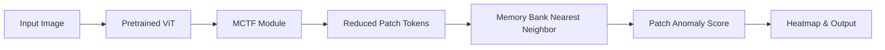

# Efficient ViT-Based Anomaly Detection with Multi-Criteria Token Fusion (MCTF)

*This is the project associated with the course Computer Vision.*

## 1. Project Overview
This project is an industrial visual anomaly detection system designed to detect defects in manufactured products (like MVTec AD dataset categories). It uses a **Vision Transformer (ViT)** backbone with PatchCore-style anomaly detection, enhanced by **Multi-Criteria Token Fusion (MCTF)** to achieve substantially faster inference and reduced FLOPs while preserving critical fine-grained defect information.

## 2. Problem Statement
Industrial inspection demands high accuracy to detect subtle defects, but also requires high throughput (low latency). Standard Vision Transformers process images using a fixed number of tokens, resulting in massive computational overhead, especially for high-resolution images where most patches contain redundant background information. 

## 3. Why ViT?
Vision Transformers have shown state-of-the-art performance in anomaly detection by capturing global context and rich patch-level features, outperforming CNNs on complex textures and structures.

## 4. Why Anomaly Detection?
Training supervised classifiers for every possible defect type is impossible in manufacturing. Anomaly detection learns only from *normal* images and identifies defects as deviations from this learned norm.

## 5. Why MCTF?
MCTF dynamically fuses redundant tokens across ViT layers. Unlike naive pooling, it uses multiple criteria to ensure important visual details (like small defects) are not lost, leading to significant FLOP reduction with minimal accuracy drop.

## 6. Architecture


## 7. MCTF Explanation
The MCTF module uses three criteria for bipartite soft-matching fusion:
- **Similarity:** Cosine similarity prevents fusing semantically different tokens.
- **Informativeness:** Uses one-step-ahead attention (from the subsequent layer) to protect highly attended (informative) tokens.
- **Token Size:** Penalizes fusing already large (highly fused) tokens to prevent representation collapse.

## 8. Dataset
The project is built around the **MVTec AD** dataset, the standard benchmark for industrial anomaly detection.

## 9. Installation
```bash
# Clone and enter the repository
git clone https://github.com/sachhu04/DefectLens.git
cd DefectLens

# Install Python requirements
pip install -r requirements.txt

# Install the project itself (editable), so `import src.*` / `backend.*` resolve
pip install -e .

# Install Frontend requirements
cd frontend
npm install

# Optional: auto-load this environment on `cd` (requires direnv; NixOS/macOS/WSL)
direnv allow
```

## 10. Dataset Setup
To automatically download a small subset (e.g., 'bottle') for testing:
```bash
make download-data CATEGORY=bottle
# or: python scripts/download_dataset.py --category bottle
```
The script tries a legacy tar.xz mirror first and automatically falls back to a
Hugging Face mirror (`foersben/mvtec-ad`) that keeps the original MVTec folder
layout for **all** categories. For the full dataset, you can also download
manually from the MVTec AD official website and place it in `data/mvtec/`.

## 11. Building the Memory Bank
Before running inference, you must extract normal features into the FAISS memory bank:
```bash
# Build both baseline and MCTF memory banks for a category
make build-mb CATEGORY=bottle

# Or build individually:
make build-mb-baseline CATEGORY=bottle
make build-mb-mctf CATEGORY=bottle

# Or build for all supported categories (bottle, cable, metal_nut):
make build-mb-all
```

## 12. Running Inference (CLI)
```bash
# Default image & mctf model:
make cli

# Custom image, model, or category:
make cli IMAGE=data/mvtec/bottle/test/broken_small/000.png MODEL=mctf CATEGORY=bottle
# or: python scripts/predict.py --image path/to/test.jpg --model mctf --category bottle
```

## 13. Running Evaluation & Tests
To evaluate AUROC and Latency over the test set:
```bash
make evaluate MODEL=mctf CATEGORY=bottle
# or: python scripts/evaluate.py --config configs/mctf.yaml --category bottle
```
To run the automated test suite and verification pipeline:
```bash
make test          # Runs both pytest suite and end-to-end integration test
make test-unit     # Runs pytest API and pipeline unit tests
make test-pipeline # Runs full 5-module verification pipeline
```
Results are written to `results/<model>_<category>_eval.json`.

**Threshold calibration:** the image-level decision threshold
(`anomaly_detector.threshold` in each config) was calibrated on `bottle`
(normal mean score ≈ 0.61–0.62, anomalous ≈ 0.87–1.02). If you evaluate or
deploy on a different category, re-calibrate: run inference over the test set,
inspect normal vs. anomalous score distributions, and pick a separating value.

## 14. Running Frontend/Backend & Benchmark Dashboard
You can start both the FastAPI backend and React frontend concurrently with a single command:
```bash
make run
# or: make ui / ./run.sh
```
Or start them individually:
```bash
# Terminal 1: Backend API (FastAPI on http://localhost:8000)
make run-backend

# Terminal 2: Frontend Dashboard (Vite + React on http://localhost:5173)
make run-frontend
```

Visit `http://localhost:5173` in your browser:
- **Inspection Tab:** Interactive visual defect localization with original image, heatmap, overlay, and suspicious region isolation.
- **Benchmark Tab:** Quantitative performance analytics dashboard with interactive charts (Latency & Throughput, Dynamic Token Pruning Curves, AUROC Retention), side-by-side architectural metrics table, and CSV export.

## 15. Results
Measured on MVTec AD `bottle` (209 train / 83 test images, DeiT-Small/16,
CPU inference, FAISS index):

| Model | Image AUROC | Pixel AUROC | Avg Latency | Tokens | Token Reduction |
|---|---|---|---|---|---|
| Baseline ViT | 0.9992 | 0.9872 | 47.0 ms | 196 | — |
| MCTF ViT | 0.9508 | 0.9277 | 34.3 ms | 23 | **88.3%** |

MCTF cuts token count (and correspondingly FLOPs/latency) by ~88% at a cost of
~5pp image AUROC on this category.

## 16. Ablation Studies
The architecture supports turning on/off specific criteria (`use_sim`, `use_info`, `use_size`) in the `configs/mctf.yaml` to observe their individual impacts on small-defect retention and latency.

## 17. Limitations & Future Work
- **Limitation:** Reconstructing the spatial heatmap from fused tokens requires complex index tracking which can introduce overhead.
- **Limitation:** Coreset subsampling is currently random rather than k-center greedy; memory-bank quality (and AUROC) could improve with greedy coverage sampling.
- **Limitation:** The decision threshold is calibrated per category (see Section 13); it does not transfer across categories without re-calibration.
- **Future Work (Defect-Aware Extension):** Implement a preliminary scoring pass to freeze tokens with high anomaly scores, preventing them from being fused regardless of similarity or informativeness.

## 18. Citation
Based heavily on the concepts from:
*Multi-criteria Token Fusion with One-step-ahead Attention for Efficient Vision Transformers*
